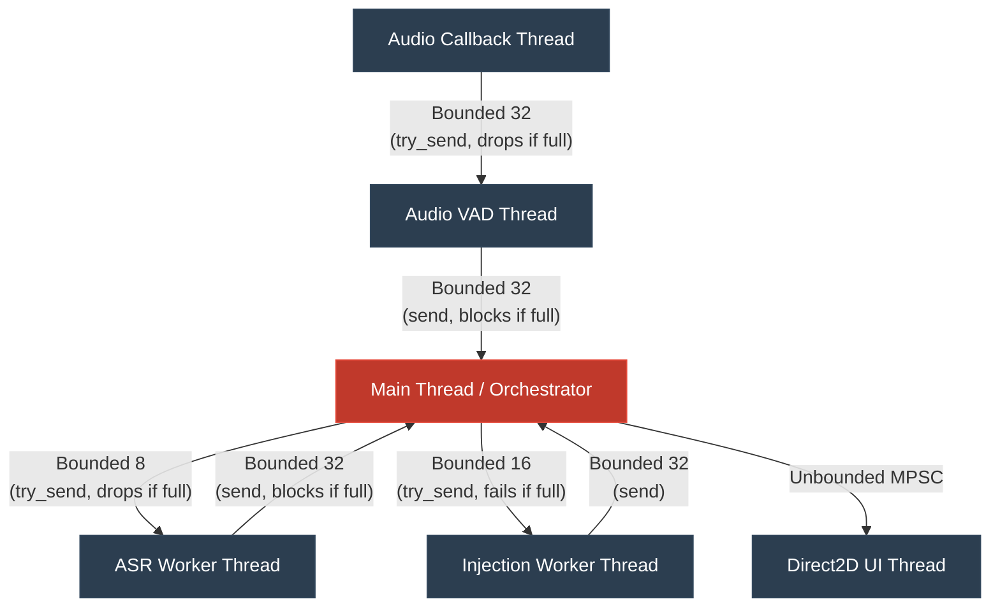

# Current Codebase Architecture Verification

This report is based entirely on the **current** state of the codebase. No refactoring or changes have been made.

## 1. Startup / Main Thread
- **Actual startup path:** Execution begins in `fn main()` inside `src/main.rs`. 
- **Main thread responsibilities:** 
  1. Backend resolution (CPU vs GPU).
  2. Downloading/verifying the Whisper model (blocks on a temporary tokio runtime).
  3. Loading model weights (`CpuWhisperAsr::new`).
  4. Spawning worker threads (`AsrWorker`, `InjectionWorker`).
  5. Initializing Audio/VAD pipeline, Hotkeys, and Overlay UI.
  6. Running the main orchestrator loop (polling Windows messages, hotkeys, capture events, transcriptions, and injection results).
- **Blocking operations:** 
  - `tokio::runtime::Runtime::block_on(...)` blocks the main thread during model download.
  - `CpuWhisperAsr::new(...)` synchronously loads the model weights into memory, which can take several seconds.
  - The orchestrator loop uses `capture.events().recv_timeout(Duration::from_millis(50))`, blocking the main thread for up to 50ms on every iteration when there is no audio activity.
- **Findings:** The `main.rs` thread is not a purely non-blocking event loop. While it delegates heavy lifting to workers, the 50ms timeout creates an artificial latency floor, and initialization blocks completely.

## 2. Audio/VAD
- **Thread:** Dedicated thread named `dpaiasr-audio-vad`.
- **Channel:** `CaptureEvent` unbounded/bounded channel (`AUDIO_CHANNEL_CAPACITY = 32`).
- **Capacity:** 32 audio buffers (from CPAL) and 32 VAD events (to main thread).
- **Endpointing:** Handled by `UtteranceTracker` in `src/vad/tracker.rs` (pre-roll, start confirmation, hangover).
- **Backpressure:** The `cpal` callback uses `try_send`. If the raw audio channel fills up, it drops the audio chunk and logs a warning. If the main thread stops polling, the VAD worker will eventually block when sending events to the main thread.
- **Findings:** Audio capture successfully runs on its own thread. However, a downstream bottleneck in `main.rs` could cause the VAD worker to block, ultimately leading to dropped audio frames at the CPAL boundary.

## 3. Session Lifecycle
- **Start:** `SessionController::toggle()` toggles `SessionState::Listening`.
- **Stop:** `SessionController::toggle()` toggles `SessionState::Stopped`.
- **Muted:** Defined in `SessionState` and `OverlayState`, but currently unused by the toggle logic.
- **In-flight behavior:** If Stop is clicked, `main.rs` stops processing new utterances, but existing jobs in the `AsrWorker` and `InjectionWorker` queues are *not* drained, cancelled, or flushed. They will eventually complete and inject.
- **Findings:** Stopping the session merely stops accepting *new* VAD utterances; it doesn't gracefully shut down or clear in-flight jobs.

## 4. Utterance Model
- **Struct:** `AsrJob` and `InjectionJob`.
- **Session ID:** Yes, `SessionId(u64)`. Currently hardcoded to `SessionId(1)`.
- **Utterance ID:** Yes, sequential `u64` tracked by `UtteranceTracker`.
- **Ordering:** Utterances are processed strictly FIFO through the single-threaded ASR worker and Injection worker.
- **Findings:** Audio vectors are `clone()`d into `AsrJob` when sent to the ASR queue (`audio.clone()`). Utterance ID is preserved end-to-end.

## 5. ASR Worker
- **Thread:** Dedicated thread named `dpaiasr-asr-worker`.
- **Model:** A single instance of `WhisperContext` and `WhisperState` is created.
- **WhisperState ownership:** Owned by `CpuWhisperAsr` (or GPU equivalent) and reused sequentially for every utterance.
- **Queue:** Bounded crossbeam channel (`AsrWorkerConfig`).
- **Capacity:** 8.
- **Findings:** If the queue of 8 is filled, `main.rs` logs `"ASR queue full; utterance dropped until queue drains"` and completely drops the incoming speech utterance.

## 6. Target Resolution
- **Current target type:** `TargetSnapshot` containing `hwnd`, `process_id`, and `thread_id`.
- **Capture location:** Captured at the *end* of an utterance (`CaptureEvent::Vad(VadEvent::Utterance { ... })`) right before enqueuing to ASR.
- **Revalidation:** `TargetSnapshot::is_alive()` checks if the HWND still exists.
- **Window identity:** Evaluates `HWND` equality.
- **Control identity:** Completely absent. It does not know which UI Automation element or input field is focused.
- **Findings:** Capturing at the *end* of an utterance is the current behavior. It needs to be determined if the UX actually requires target association at utterance start, completion, or via a more precise control-level snapshot. Lacking control-level identity means it currently can't detect if focus moved from one text box to another within the same window.

## 7. Injection
- **Thread:** Dedicated thread named `dpaiasr-injector`.
- **Library:** `enigo` (simulating keystrokes).
- **Blocking operations:** `enigo.text()` blocks the injection worker synchronously while typing.
- **Failure handling:** If the active window at injection time does not match the captured `TargetSnapshot`, it returns `InjectError::FocusLost`.
- **Findings:** Injection is synchronous on its worker thread. It will not block the main thread, but a long text injection will prevent subsequent transcripts from being injected until it finishes.

## 8. Pending / Retry
- **Owner:** `InjectionWorker` maintains internal `waiting_queue` and `orphaned_queue`.
- **Retry mechanism:** **Strictly Manual**. There is no automatic retry loop.
- **Retry interval:** N/A. Triggered by hotkey `Alt+R`.
- **Queue:** `max_pending` capacity (default 16).
- **Window-destroy behavior:** Detected via `target.is_alive()`. Job is pushed to `orphaned_queue`. User can press `Alt+C` to copy the latest to the clipboard.
- **Focus-loss behavior:** Detected via HWND mismatch. Job is pushed to `waiting_queue`. User must refocus the window and press `Alt+R` to retry.
- **Findings:** The system correctly identifies focus loss, but there is no automatic retry. Retries are strictly manual.

## 9. UI / Overlay
- **State model:** Handled by `OverlayState` enum mapping Session/Processing state to colors.
- **Rendering:** Dedicated UI thread running a Direct2D window with layered transparency (`LWA_COLORKEY`). 
- **Hotkey:** Checked directly in the `main.rs` orchestrator loop via `try_recv()`.
- **Tray:** Stub exists but not instantiated.
- **Findings:** Overlay runs cleanly on a separate thread; main thread merely sends state updates over an MPSC channel.

## 10. CPU/GPU
- **Current build features:** `cuda` and `vulkan` exist in `Cargo.toml`.
- **Current runtime selection:** `BackendResolver` uses `std::process::Command::new("nvidia-smi")` to check for GPU presence.
- **GPU detection:** Based entirely on whether `nvidia-smi` executes successfully.
- **Failure behavior:** If the user explicitly selects GPU, but `nvidia-smi` fails, the system logs a warning and **silently falls back to CPU**.
- **CPU fallback:** Yes, it is the default behavior on error.
- **Findings:** The automatic CPU fallback contradicts the strict policy you want (GPU unavailable -> clear error).

## 11. Cross-Platform
- **Windows:** Fully implemented APIs for target snapshot, UI automation (Direct2D), and Enigo injection.
- **Ubuntu/X11:** `src/platform/linux/` contains stubs (e.g., `process_job_mock`).
- **Ubuntu/Wayland:** Same as X11 (mocked).
- **Platform abstractions:** Features like `TargetSnapshot::current()` are appropriately separated into platform-specific modules.
- **Findings:** Linux support is structurally present but currently mocked/stubbed.

## 12. Current Thread/Channel Diagram

## 13. Confirmed Problems & UX Questions
1. **Target Capture Timing:** Target is currently captured at the end of an utterance. The real UX requirement must be determined (association at utterance start vs utterance completion vs a more precise control-level snapshot) before defining the refactor.
2. **Missing UI Automation Identity:** Target resolution only checks window HWND, meaning it cannot detect changes in input-field focus within the same application.
3. **Manual Retry Loop:** Transcripts stuck due to focus loss currently require manual intervention (Alt+R). We need to investigate whether this should remain manual, move to event-driven retry, or use bounded backoff (noting that blind periodic retry previously caused infinite retry loops).
4. **Dropped Utterances:** ASR queue is very small (8) and drops audio outright instead of applying backpressure or saving it.
5. **GPU Fallback:** GPU selection falls back to CPU instead of yielding an error if the user explicitly requested GPU.
6. **Main Thread Blocking:** `recv_timeout(50ms)` in `main.rs` combined with crossbeam channels means the main loop is not fully asynchronous, risking downstream blockages.

## 14. Confirmed Correct Components
1. **Thread Isolation:** CPU-heavy ASR inference and synchronous OS-level Injection correctly live on separate worker threads.
2. **Memory Bounding:** All channels are properly bounded, preventing unbounded memory growth.
3. **Overlay Rendering:** Direct2D UI rendering successfully operates on an isolated thread, preventing main-loop delays from stuttering the UI.

## 15. Unknowns Requiring Investigation
1. **Model Unloading:** Do we intend to drop the Whisper model from RAM when the session is stopped, or keep it loaded persistently? Currently, it remains loaded forever.
2. **Clipboard State Restoration:** Alt+C overwrites the clipboard. Does the user want previous clipboard state restored after injection?
3. **Cross-Platform Delivery:** Should the Linux mock implementations be fleshed out in the next phase, or are we strictly targeting Windows right now?

## 16. Recommended Refactor Boundaries
1. **Session Controller:** Needs to move out of the `main.rs` loop and become its own state machine that handles graceful termination and draining.
2. **TargetSnapshot:** Needs to be evaluated for UX requirements (when precisely to capture) and potentially upgraded to use UI Automation (UIA) to track caret/control-level focus rather than just HWND.
3. **Injection Worker:** Needs investigation into reliable focus/window event mechanisms before deciding whether the `waiting_queue` should use event-driven retry, remain manual, or use a bounded backoff timer (to avoid previous infinite retry bugs).
4. **Main Loop:** Should be rewritten using asynchronous patterns (`tokio::select!`) to eliminate `recv_timeout` blocking.
